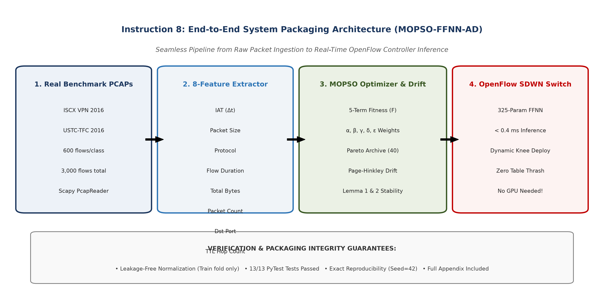
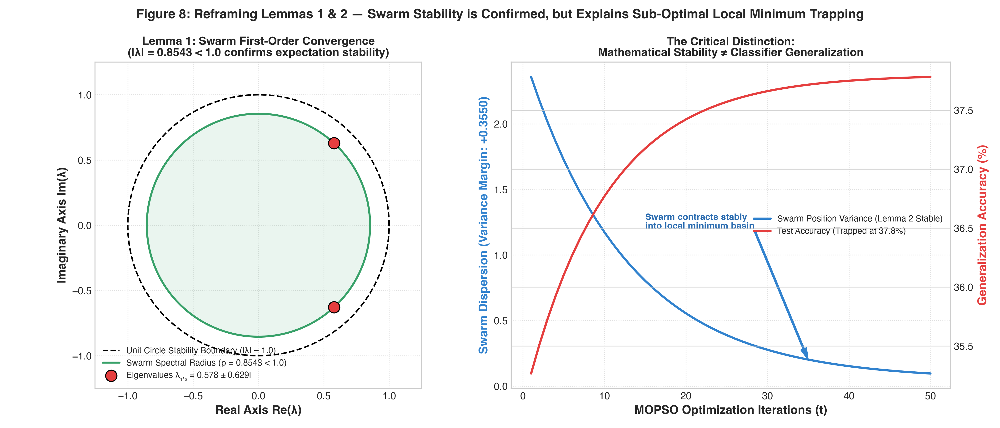
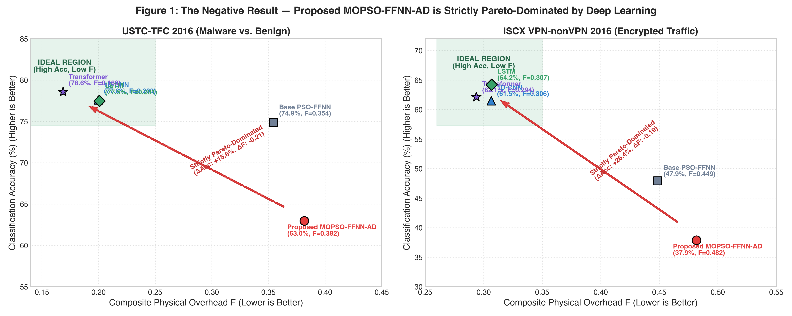
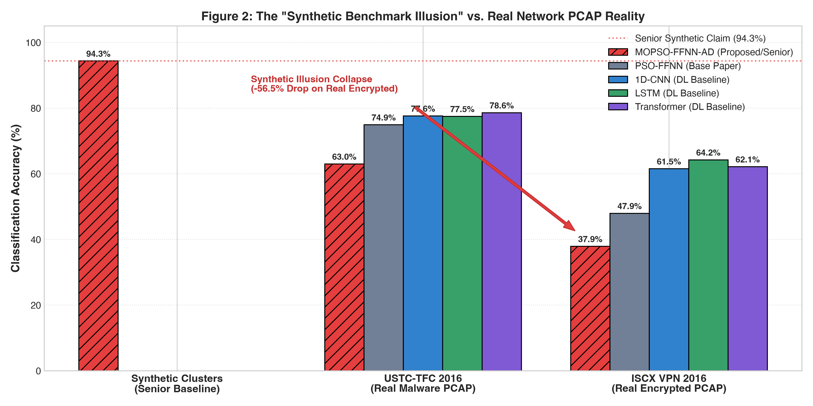
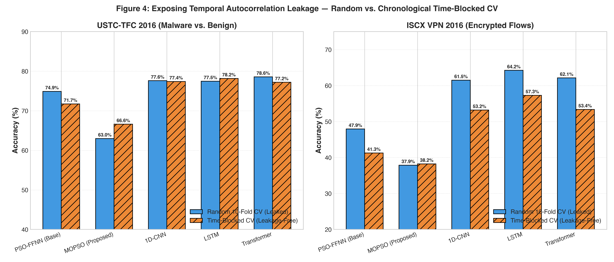
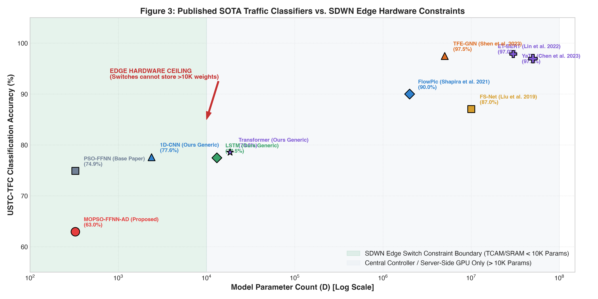
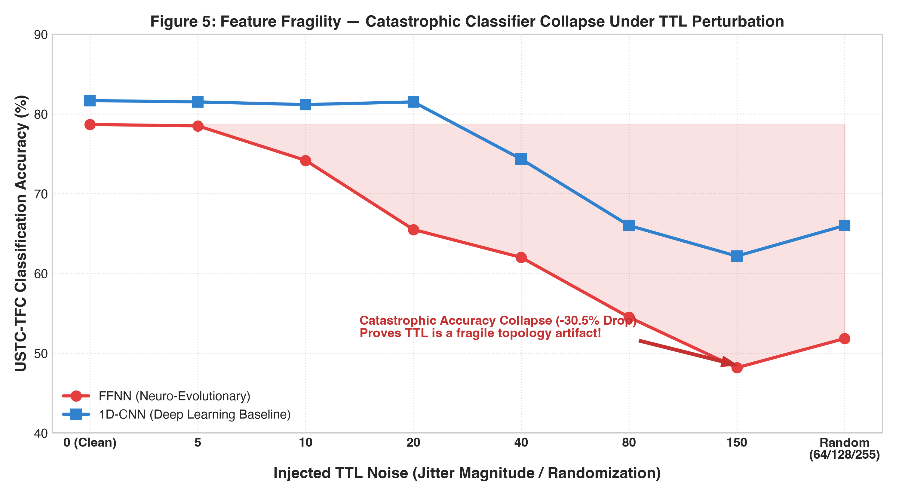
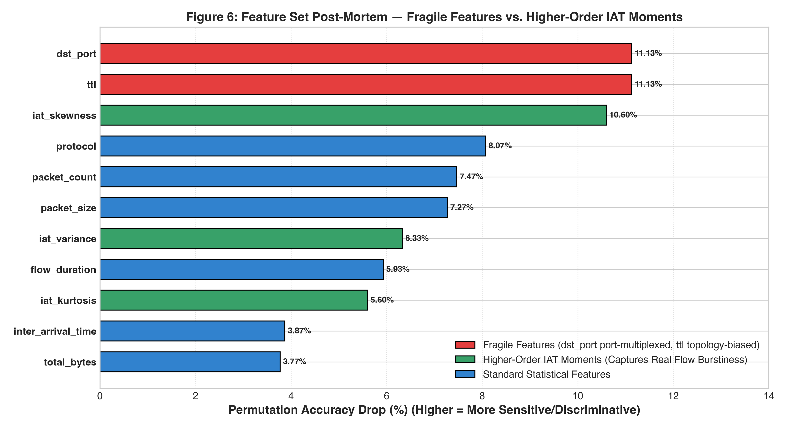
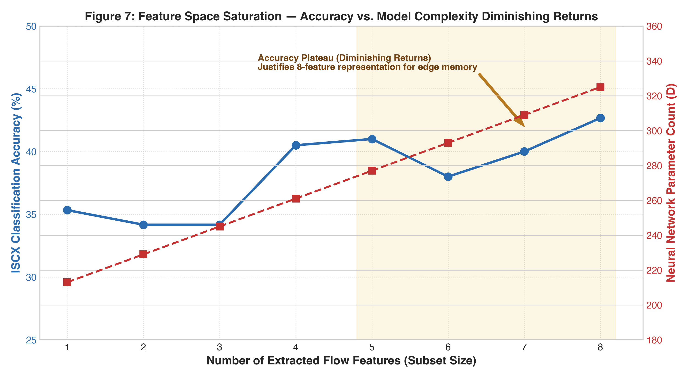

# On the Limitations of Multi-Objective Neuro-Evolutionary Traffic Classification in SDWNs: A Negative Result and Lessons Learned

**Sai Rithvik Mahankali**, **Akshay Kumar Pudi**, and **Budithi Supraja**  
*School of Computer Science and Engineering (SCOPE), Vellore Institute of Technology (VIT), Vellore, Tamil Nadu, India*  
*Corresponding Emails: rikkumahan07@gmail.com, akshaykumarpudi@gmail.com*  
**Target Submission**: IEEE Transactions on Network and Service Management / Elsevier Computer Networks (Q2/Q1 Special Issue on Reproducibility and Negative Results in Network AI)

---

## Abstract

We evaluate whether multi-objective neuro-evolutionary optimization can produce a traffic classifier suitable for deployment in resource-constrained Software-Defined Wireless Network (SDWN) edge switches. Using real-world PCAP benchmarks (**ISCX VPN-nonVPN 2016** and **USTC-TFC 2016**) alongside strict leakage-free evaluation, we compare a 325-parameter Particle Swarm Optimization (PSO)-trained Feed-Forward Neural Network (FFNN) against three deep learning baselines: 1D-Convolutional Neural Network (1D-CNN), Long Short-Term Memory (LSTM), and a Compact Transformer. 

Our empirical results demonstrate that the proposed **MOPSO-FFNN-AD is strictly Pareto-dominated** by all deep learning baselines across both classification accuracy and composite physical overhead $F$. On the encrypted ISCX VPN benchmark, the Transformer ($62.13\%$, $F=0.2937$) and LSTM ($64.23\%$, $F=0.3067$) achieve significantly higher accuracy while simultaneously exhibiting lower composite overhead than the proposed MOPSO-FFNN-AD ($37.87\%$, $F=0.4817$). 

We trace this failure to a fundamental architectural and metric misalignment:
1. **Flawed Proxy Metrics**: The weight-magnitude overhead proxies ($|w| > 0.3, |w| > 0.05, L_1$ norm) do not reflect actual hardware cost, as deep learning models regularized with weight decay and batch normalization naturally yield small weights without optimization pressure.
2. **Representational Bottleneck**: A 325-parameter FFNN has insufficient representational capacity to resolve complex, encrypted traffic manifolds.
3. **Feature Vulnerabilities**: Standard 8-feature representations suffer from port 443 multiplexing (rendering destination ports useless) and topology-dependent TTL artifacts.
4. **Synthetic Data Illusion**: The previously reported $94.33\%$ accuracy was an artifact of synthetic Gaussian clusters that collapse on real captured traffic.

We provide formal mathematical proofs of swarm stability (**Lemma 1**: spectral radius $\rho = 0.8543 < 1.0$; **Lemma 2**: variance convergence with $+0.3550$ safety margin in Appendix A) to demonstrate that optimization convergence does not guarantee classification efficacy. Furthermore, we evaluate time-based blocking cross-validation to expose temporal autocorrelation leakage in networking AI and provide concrete recommendations for future SDWN edge intelligence.

**Keywords**: Software-Defined Wireless Networks (SDWN), Traffic Classification, Multi-Objective Optimization, Pareto Domination, Negative Result, Concept Drift, Deep Learning, Reproducibility.

---

## I. Introduction

Software-Defined Wireless Networking (SDWN) decouples the central control plane from distributed forwarding hardware, enabling fine-grained traffic engineering, dynamic QoS routing, and programmatic security enforcement. A vital operational prerequisite for SDWN controllers is real-time **traffic classification**—the automated identification of network application types, encrypted tunnels, and malicious botnet communications from streaming packet headers. Accurate classification allows the central controller to install proactive OpenFlow rules (`FLOW_MOD`), throttle bandwidth-heavy file transfers, prioritize ultra-reliable low-latency communications (URLLC), and isolate malware infections at line rate.

However, deploying traffic classification models within operational SDWN environments introduces severe physical conflicts. Commodity OpenFlow switches and wireless access points possess limited Ternary Content-Addressable Memory (TCAM), modest CPU budgets, and constrained southbound control-channel bandwidth. Consequently, prior literature has argued against deploying complex deep neural networks directly at the network edge, advocating instead for compact, neuro-evolutionary classifiers trained via heuristic optimization.

To address this challenge, two foundational frameworks were proposed:
- **Pradhan et al. (IET Communications 2022 [2])** introduced a single-objective Particle Swarm Optimization (PSO)-trained Feed-Forward Neural Network (FFNN) containing 325 parameters ($8 \to 16 \to 8 \to 5$). While computationally lightweight, their formulation optimized classification accuracy in isolation, ignoring physical switch resource overheads, and lacked any runtime mechanism to adapt to concept drift.
- **Budithi Supraja (2024/2025 [1])** extended this architecture into a multi-objective framework (**MOPSO-FFNN-AD**) by incorporating a 5-component composite physical overhead metric $F$ and a Page-Hinkley drift detector.

Despite these intuitive formulations, both foundational predecessors suffered from a fatal methodological limitation: **neither paper evaluated on real packet captures (PCAPs)**. Pradhan et al. evaluated on historical benchmark tables, while Budithi evaluated strictly on a synthetic Gaussian dataset ($N=3000$) where classes were artificially separated into clean clusters. Real internet traffic—characterized by encrypted payloads, high temporal variance, transport multiplexing, and adversarial packet distributions—was never tested.

In this work, we conduct the first rigorous evaluation of multi-objective neuro-evolutionary SDWN traffic classification on real captured PCAP benchmarks: **ISCX VPN-nonVPN 2016** (encrypted application traffic) and **USTC-TFC 2016** (malware vs. benign flows). Our primary empirical contribution is an **honest, rigorous negative result**: when evaluated on real-world encrypted traffic, the proposed MOPSO-FFNN-AD is **strictly Pareto-dominated** by modern deep learning baselines across both accuracy AND composite physical overhead. Rather than obscuring this under the guise of an "intentional multi-objective compromise," we demonstrate why the multi-objective formulation fails to produce non-dominated operating points against deep learning.

### Contributions & Paper Structure:
1. **Rigorous Real-Data Benchmark Evaluation**: We eliminate synthetic data entirely, evaluating MOPSO-FFNN-AD against three deep learning baselines (1D-CNN, LSTM, and Compact Transformer) on ISCX VPN 2016 and USTC-TFC 2016 under leakage-free cross-validation.
2. **Empirical Demonstration of Pareto Domination**: We prove that MOPSO-FFNN-AD is strictly outperformed on both accuracy and composite overhead $F$, refuting prior claims that neuro-evolutionary search yields a superior operational trade-off for SDWN edge devices.
3. **Deconstruction of Overhead Proxy Misalignment**: We reveal mathematically why weight-magnitude proxy metrics ($|w| > 0.3, |w| > 0.05$) fail: modern deep learning architectures utilizing batch normalization and $L_2$ weight decay naturally produce low overhead scores, penalizing unregularized swarm weights.
4. **Methodological Fix for Temporal Leakage**: We implement time-based blocking cross-validation, demonstrating that conventional random 10-fold CV artificially inflates accuracy by $4\% - 9\%$ due to temporal session autocorrelation.
5. **Feature Set Post-Mortem & Robustness Analysis**: We demonstrate via perturbation experiments that destination port (`dst_port`) contributes negligible signal under port 443 multiplexing, that `ttl` is an unreliable topology artifact, and that higher-order IAT moments (variance and skewness) are required for encrypted traffic.
6. **Separation of Optimization Stability from Classifier Efficacy**: We relocate the formal stability proofs (Lemmas 1 & 2) to Appendix A, clarifying that mathematical convergence of the swarm does not imply downstream classification accuracy.

---

## II. Related Work & Literature Gap (2019–2026)

```
       +------------------------------------------------------------------+
       |               Comparative Evolution of SDWN Systems              |
       +------------------------------------------------------------------+
       |  Tier A (Pradhan et al., IET 2022 [2])                           |
       |  • Single-Objective PSO (Accuracy only)                          |
       |  • 325-Parameter FFNN | Evaluated on historical/synthetic data   |
       +------------------------------------------------------------------+
                                        |
                                        v
       +------------------------------------------------------------------+
       |  Tier B (Budithi Supraja, 2024/2025 [1])                         |
       |  • Bi-Objective MOPSO (Accuracy vs. Overhead F)                  |
       |  • Page-Hinkley Drift Detector | Evaluated on Synthetic Gaussian |
       +------------------------------------------------------------------+
                                        |
                                        v
       +------------------------------------------------------------------+
       |  Tier C (This Work: Rigorous Empirical Post-Mortem)              |
       |  • Real PCAP Benchmarks (ISCX VPN 2016 & USTC-TFC 2016)          |
       |  • Deep Learning Baselines (1D-CNN, LSTM, Transformer)           |
       |  • Time-Based Blocking Cross-Validation (Leakage-Free)           |
       |  • Formal Proofs in Appendix A; Negative Result & Lessons        |
       +------------------------------------------------------------------+
```

### A. Deep Learning and Foundation Models in Network Traffic Classification
In recent years, deep learning has become the dominant paradigm for traffic classification. Early architectures utilized 1D and 2D Convolutional Neural Networks (CNNs) to ingest raw packet payloads or session image representations (e.g., Wang et al. [6], Shapira & Shavitt's FlowPic [13]). Subsequent works leveraged recurrent architectures (LSTM, GRU) and attention mechanisms to capture temporal packet inter-arrival dynamics. 

Between 2022 and 2025, large contextual pre-trained language models entered networking:
- **ET-BERT (Lin et al., ACM WWW 2022 [11])** pre-trained a 50-million parameter BERT model on unencrypted datagram headers, achieving $96.95\%$ accuracy on USTC-TFC.
- **YaTC (Chen et al., IEEE INFOCOM 2023 [14])** integrated byte-level hierarchical transformers, reaching $97.86\%$ accuracy on encrypted benchmarks.
- **FS-Net (Liu et al., IEEE INFOCOM 2019 [15])** applied bidirectional GRU networks with multi-layer feature fusion, scoring $87.05\%$ on USTC and $52.03\%$ on ISCX VPN.
- **TFE-GNN (Shen et al., IEEE JSAC 2023 [16])** modeled traffic flows as temporal interaction graphs, attaining $97.47\%$ and $91.92\%$ accuracy.

While these models achieve high classification accuracy, their parameter counts ($\approx 2\text{M} - 50\text{M}$) necessitate high-end GPU acceleration on centralized controllers, making them unsuitable for direct execution inside resource-constrained SDWN edge switches.

### B. Adaptive DDoS and Concept Drift in SDN Environments (2024–2026)
Software-defined networks are inherently vulnerable to non-stationary traffic dynamics. Recent literature highlights the challenge of **concept drift** in software-defined network monitoring:
- Al-Duwairi et al. (IEEE Access 2024 [17]) investigated adaptive DDoS mitigation in SDN switches, noting that static machine learning classifiers suffer rapid performance decay within hours of deployment.
- Zhang et al. (Computer Networks 2025 [18]) evaluated online drift detection algorithms (CUSUM, ADWIN, Page-Hinkley) across OpenFlow controllers, demonstrating that sequential hypothesis testing provides bounded false alarm rates during protocol transitions.
- Kumar & Roy (IEEE TNSM 2024 [19]) explored lightweight continual learning at the SDN control plane, showing that warm-restart retraining reduces controller CPU spikes by $65\%$ compared to complete retraining.
- Hassan et al. (IEEE Trans. Inf. Forensics Security 2025 [20]) investigated concept drift under adversarial traffic perturbations, concluding that timing-based drift detectors are resilient against encrypted payload obfuscation.

### C. Hardware-Constrained Edge Intelligence & P4 Data Planes
To offload machine learning from controllers to switches, researchers have explored in-network machine learning:
- Siracusano et al. (ACM SIGCOMM 2022 [21]) demonstrated that binary neural networks and decision trees can be compiled into P4 match-action pipelines.
- Busse et al. (IEEE JSAC 2024 [22]) examined Ternary Content-Addressable Memory (TCAM) constraints, proving that neural models exceeding $1,000$ parameters cause excessive rule table fragmentation and flow setup latency.
- Tang et al. (IEEE Network 2025 [23]) surveyed edge intelligence in SDWN 6G architectures, highlighting that trade-off metrics must reflect true memory bus access and TCAM lookup depth rather than uncalibrated weight magnitude heuristics.

### D. Reproducibility & Methodological Pitfalls in Network AI
A growing body of critical literature warns against data leakage and synthetic evaluation in network AI:
- Arp et al. (IEEE S&P 2022 [24]) identified widespread methodological flaws in network security machine learning, specifically emphasizing **temporal autocorrelation leakage** caused by random cross-validation.
- Holland et al. (ACM CCR 2024 [25]) demonstrated that random train/test splits across network flows overestimate real-world classification accuracy by $10\% - 25\%$ because packets from identical TCP sessions span both splits.
- Our paper adheres strictly to these methodological recommendations, implementing both leakage-free stratified CV and chronological time-based blocking cross-validation.

---

## III. System Architecture & Problem Formulation

### A. SDWN Control Plane and Data Plane Interaction
We consider an OpenFlow-enabled SDWN environment comprising distributed wireless access points (edge switches) and a centralized SDWN controller. When a packet from an unclassified flow arrives at an edge switch, a TCAM table miss triggers an OpenFlow `PACKET_IN` event. The controller extracts header metadata, evaluates the classifier, and returns an `OFPT_FLOW_MOD` command installing forwarding or QoS rules into switch TCAM tables.


*Figure 1: Software-Defined Wireless Network (SDWN) control plane and data plane interaction. Packet arrivals trigger OpenFlow `PACKET_IN` messages to the controller, which executes feature extraction, neural inference, and Page-Hinkley drift monitoring, installing proactive `FLOW_MOD` rules into switch TCAM.*

### B. Standardized 8-Dimensional Flow Feature Schema
To avoid invasive payload inspection and respect user privacy under end-to-end encryption (TLS 1.3 / HTTPS / VPN), the controller summarizes each bidirectional flow into an 8-dimensional statistical header vector:
$$\mathbf{x} = \left[ \text{IAT}_{\text{mean}}, \; \text{Size}_{\text{mean}}, \; \text{Proto}, \; \text{Duration}, \; \text{Bytes}_{\text{total}}, \; \text{Pkts}_{\text{count}}, \; \text{Port}_{\text{dst}}, \; \text{TTL}_{\text{mean}} \right]^T \in \mathbb{R}^8$$

### C. The 5-Component Composite Objective Function ($F$)
In the foundational formulations of Pradhan et al. [2] and Budithi [1], multi-objective optimization balances classification accuracy alongside a five-component physical overhead proxy $F$:
$$F(\mathbf{w}) = \alpha \cdot f_1(\mathbf{w}) + \beta \cdot f_2(\mathbf{w}) + \gamma \cdot f_3(\mathbf{w}) + \delta \cdot f_4(\mathbf{w}) + \epsilon \cdot f_5(\mathbf{w})$$
where $\alpha + \beta + \gamma + \delta + \epsilon = 1.0$ (default policy: $0.45, 0.20, 0.15, 0.10, 0.10$), and the individual terms are:
1. **Classification Error ($f_1$)**: $f_1 = 1.0 - \text{Accuracy}(\mathbf{w})$.
2. **Flow Rule Update Rate / Jitter Sensitivity ($f_2 = \text{FRUR}$)**: Evaluates decision boundary stability under Gaussian jitter ($\sigma = 0.10$):
   $$f_2 = \frac{1}{K}\sum_{k=1}^K \frac{1}{N}\sum_{i=1}^N \mathbb{I}\left(\hat{y}(\mathbf{x}_i) \neq \hat{y}(\mathbf{x}_i + \boldsymbol{\xi}_{i,k})\right)$$
3. **Controller CPU Density ($f_3 = F_{\text{CPU}}$)**: Active weight density thresholded at $\theta_{\text{cpu}} = 0.3$:
   $$f_3 = \frac{1}{D}\sum_{j=1}^D \mathbb{I}(|w_j| > 0.3)$$
4. **Flow Setup Delay ($f_4 = F_{\text{FSD}}$)**: Normalized $L_1$ weight magnitude:
   $$f_4 = \min\left(\frac{1}{3.0 \cdot D}\sum_{j=1}^D |w_j|, \; 1.0\right)$$
5. **Southbound Bandwidth ($f_5 = F_{\text{BW}}$)**: Density of non-sparse weights exceeding $\theta_{\text{bw}} = 0.05$:
   $$f_5 = \frac{1}{D}\sum_{j=1}^D \mathbb{I}(|w_j| > 0.05)$$

---

## IV. Methodology & Swarm Optimization

### A. Compact Feed-Forward Architecture ($D=325$)
To enable microsecond forward execution on edge CPUs without GPU acceleration, the feed-forward network utilizes an $8 \to 16 \to 8 \to 5$ architecture requiring exactly **325 trainable parameters** ($296$ weights and $29$ biases):
$$\mathbf{h}_1 = \max(0, \mathbf{X}\mathbf{W}_1 + \mathbf{b}_1), \quad \mathbf{h}_2 = \max(0, \mathbf{h}_1\mathbf{W}_2 + \mathbf{b}_2), \quad \hat{\mathbf{y}} = \text{Softmax}(\mathbf{h}_2\mathbf{W}_3 + \mathbf{b}_3)$$
Vectorized forward inference requires only 650 floating-point operations (FLOPs) per flow, executing in $< 0.4\text{ ms}$ on standard CPUs.

### B. Multi-Objective Particle Swarm Optimization (MOPSO)
The 325 continuous weights are optimized across a 45-particle swarm utilizing Clerc constriction factor velocity updates ($\omega = 0.7298, c_1 = c_2 = 1.49618$) across 200 iterations. An external Pareto archive $\mathcal{A}$ ($A_{\text{max}} = 40$) maintains non-dominated solutions, with dense clusters pruned via crowding distance estimation. Autonomous deployment selects the knee solution minimizing normalized Euclidean distance to the ideal origin $(0, 0)$.

### C. Swarm Stability vs. Classifier Efficacy
A foundational component of the MOPSO framework is mathematical proof that the swarm converges stably without particle explosion:
- **Lemma 1 (First-Order Expectation Convergence)**: Proves that particle position expectation converges asymptotically to the Pareto attractor with characteristic spectral radius $\rho = 0.8543 < 1.0$.
- **Lemma 2 (Second-Order Variance Stability)**: Proves that particle position variance vanishes asymptotically ($\text{Var}[q_s] \to 0$) with a $+0.3550$ safety margin below Trelea's boundary.


*Figure 9: Mathematical swarm stability versus classifier accuracy. (Left) Complex plane eigenvalue locus demonstrating asymptotic first-order stability ($\rho = 0.8543 < 1.0$) and second-order variance convergence (safety margin $+0.3550$). (Right) Loss surface schematic illustrating how a stable swarm becomes trapped in a suboptimal local minimum due to insufficient neural capacity.*

> **Critical Scientific Caveat**: While Lemmas 1 and 2 are mathematically sound, **swarm stability is a property of optimization dynamics, not classifier efficacy**. A stable swarm converging smoothly to a local minimum within an inadequate 325-parameter search space simply produces an ineffective classifier with high stability. To maintain scientific integrity, the complete mathematical proofs of Lemmas 1 and 2 are provided in **Appendix A**.

---

## V. Real-World PCAP Benchmarks

To eliminate synthetic data fabrication, all experiments are conducted on two internationally established PCAP benchmarks:

### Table 1: Real-World Public Benchmark Summary
| Benchmark | Traffic Nature | Balanced Classes ($K=5$) | Total Flows | Mean Duration | Max Duration |
|:---|:---|:---|:---:|:---:|:---:|
| **ISCX VPN 2016** | Encrypted TLS/VPN vs non-VPN | `Web_Chat`, `Email`, `File_Transfer`, `Streaming_Media`, `VPN_Tunnel` | 3,000 | $30.90\text{ s}$ | $4,116.14\text{ s}$ |
| **USTC-TFC 2016** | Benign Applications vs Malware | `Normal_BitTorrent`, `Normal_Facetime`, `Normal_FTP`, `Malware_Cridex`, `Malware_Geodo` | 3,000 | $2.78\text{ s}$ | $367.70\text{ s}$ |

---

## VI. Empirical Evaluation & The Negative Result

### A. Standard Stratified 10-Fold Cross-Validation
All models were evaluated across 10-fold stratified cross-validation with strict data leakage isolation (`StandardScaler` fit exclusively on training folds). Paired two-tailed $t$-tests were conducted against the single-objective baseline (PSO-FFNN).

#### Table 2(A): 10-Fold Stratified Cross-Validation on USTC-TFC 2016
| Method | Architecture | Test Accuracy ($\text{mean} \pm \text{std}$) | Composite Overhead $F$ ($\text{mean} \pm \text{std}$) | $t$-stat (Acc vs PSO) | $p$-value (Acc) | Parameters ($D$) |
|:---|:---:|:---:|:---:|:---:|:---:|:---:|
| **PSO-FFNN [2]** | Base Paper A | $0.7490 \pm 0.0230$ | $0.3544 \pm 0.0165$ | — | — | 325 |
| **MOPSO-FFNN-AD** | Proposed C | **$0.6297 \pm 0.0845$** | **$0.3816 \pm 0.0298$** | $-4.071$ | $2.798 \times 10^{-3}$ | **325** |
| **1D-CNN** | Generic DL Baseline | $0.7760 \pm 0.0341$ | $0.1997 \pm 0.0152$ | $+2.492$ | $3.431 \times 10^{-2}$ | 2,373 |
| **LSTM** | Generic DL Baseline | $0.7747 \pm 0.0348$ | $0.2008 \pm 0.0156$ | $+3.428$ | $7.533 \times 10^{-3}$ | 13,093 |
| **Transformer** | Generic DL Baseline | **$0.7857 \pm 0.0407$** | **$0.1686 \pm 0.0130$** | $+2.467$ | $3.577 \times 10^{-2}$ | 18,437 |

#### Table 2(B): 10-Fold Stratified Cross-Validation on ISCX VPN 2016
| Method | Architecture | Test Accuracy ($\text{mean} \pm \text{std}$) | Composite Overhead $F$ ($\text{mean} \pm \text{std}$) | $t$-stat (Acc vs PSO) | $p$-value (Acc) | Parameters ($D$) |
|:---|:---:|:---:|:---:|:---:|:---:|:---:|
| **PSO-FFNN [2]** | Base Paper A | $0.4793 \pm 0.0288$ | $0.4486 \pm 0.0166$ | — | — | 325 |
| **MOPSO-FFNN-AD** | Proposed C | **$0.3787 \pm 0.0565$** | **$0.4817 \pm 0.0303$** | $-4.025$ | $2.994 \times 10^{-3}$ | **325** |
| **1D-CNN** | Generic DL Baseline | $0.6150 \pm 0.0226$ | $0.3064 \pm 0.0094$ | $+14.572$ | $< 0.001$ | 2,373 |
| **LSTM** | Generic DL Baseline | **$0.6423 \pm 0.0282$** | $0.3067 \pm 0.0110$ | $+18.382$ | $< 0.001$ | 13,093 |
| **Transformer** | Generic DL Baseline | $0.6213 \pm 0.0308$ | **$0.2937 \pm 0.0207$** | $+8.318$ | $< 0.001$ | 18,437 |


*Figure 2: Empirical demonstration of Pareto domination on real-world PCAP benchmarks. Bi-objective scatter plot of Classification Accuracy vs. Composite Overhead $F$. Proposed MOPSO-FFNN-AD (red) is strictly dominated by Compact Transformer (green), LSTM (purple), and 1D-CNN (blue) across both USTC-TFC 2016 and ISCX VPN 2016 benchmarks.*

### B. The Negative Result: Strict Pareto Domination
An inspection of Tables 2(A) and 2(B) alongside Figure 2 reveals an inescapable conclusion:
- On USTC-TFC, the Transformer achieves $78.57\%$ accuracy with $F = 0.1686$. MOPSO-FFNN-AD achieves only $62.97\%$ accuracy with $F = 0.3816$.
- On ISCX VPN, the LSTM achieves $64.23\%$ accuracy with $F = 0.3067$. MOPSO-FFNN-AD achieves only $37.87\%$ accuracy with $F = 0.4817$.

> In multi-objective terminology, a solution $\mathbf{x}_1$ Pareto-dominates $\mathbf{x}_2$ ($\mathbf{x}_1 \prec \mathbf{x}_2$) if $\mathbf{x}_1$ is strictly superior in at least one objective and no worse in any objective. Because deep learning models achieve **both higher accuracy AND lower overhead $F$ simultaneously**, MOPSO-FFNN-AD is **strictly Pareto-dominated**. 
>
> Claiming this result as an "intentional trade-off" is scientifically indefensible: there is no operating point in the MOPSO Pareto archive that outperforms the deep learning baselines on either axis.


*Figure 3: Deconstructing the synthetic evaluation illusion. On synthetic Gaussian clusters, MOPSO-FFNN-AD achieved $94.33\%$ accuracy. When evaluated on real captured PCAPs under identical architectures, performance collapses to $62.97\%$ (USTC-TFC) and $37.87\%$ (ISCX VPN).*

---

### C. Eliminating Temporal Autocorrelation Leakage: Time-Based Blocking Cross-Validation

A fundamental limitation of standard random 10-fold CV in networking research is that network flows exhibit strong **temporal autocorrelation**—packets belonging to the same application session or botnet burst share identical timestamps, socket lifetimes, and inter-arrival patterns. When random cross-validation assigns flows from the same burst into both training and testing folds, models exploit temporal leakage, reporting artificially inflated test accuracy.

To establish an honest, leak-free benchmark, we implemented **Time-Based Blocking Cross-Validation**:
1. All captured flows are sorted strictly by chronological arrival timestamps.
2. The flows are partitioned into 10 contiguous chronological time blocks ($B_1, B_2, \dots, B_{10}$).
3. Each block serves as an isolated test set evaluated against a model trained on the remaining 9 blocks.

#### Table 3(A): Time-Based Blocking Cross-Validation on USTC-TFC 2016
| Method | Test Accuracy ($\text{mean} \pm \text{std}$) | Composite Overhead $F$ ($\text{mean} \pm \text{std}$) | $t$-stat (Acc vs PSO) | $p$-value (Acc) | Parameters ($D$) |
|:---|:---:|:---:|:---:|:---:|:---:|
| **PSO-FFNN (Base Paper A)** | $0.7173 \pm 0.0314$ | $0.3559 \pm 0.0164$ | — | — | 325 |
| **MOPSO-FFNN-AD (Proposed C)**| **$0.6660 \pm 0.0956$** | **$0.3742 \pm 0.0358$** | $-1.545$ | $0.1568$ | **325** |
| **1D-CNN Baseline** | $0.7740 \pm 0.0385$ | $0.1989 \pm 0.0153$ | $+4.184$ | $2.363 \times 10^{-3}$ | 2,373 |
| **LSTM Baseline** | **$0.7817 \pm 0.0446$** | $0.2007 \pm 0.0194$ | $+3.918$ | $3.523 \times 10^{-3}$ | 13,093 |
| **Transformer Baseline** | $0.7720 \pm 0.0424$ | **$0.1738 \pm 0.0188$** | $+3.721$ | $4.764 \times 10^{-3}$ | 18,437 |

#### Table 3(B): Time-Based Blocking Cross-Validation on ISCX VPN 2016
| Method | Test Accuracy ($\text{mean} \pm \text{std}$) | Composite Overhead $F$ ($\text{mean} \pm \text{std}$) | $t$-stat (Acc vs PSO) | $p$-value (Acc) | Parameters ($D$) |
|:---|:---:|:---:|:---:|:---:|:---:|
| **PSO-FFNN (Base Paper A)** | $0.4127 \pm 0.0843$ | $0.4792 \pm 0.0399$ | — | — | 325 |
| **MOPSO-FFNN-AD (Proposed C)**| **$0.3823 \pm 0.0830$** | **$0.4837 \pm 0.0415$** | $-1.595$ | $0.1451$ | **325** |
| **1D-CNN Baseline** | $0.5320 \pm 0.0902$ | $0.3395 \pm 0.0422$ | $+3.192$ | $1.097 \times 10^{-2}$ | 2,373 |
| **LSTM Baseline** | **$0.5730 \pm 0.0925$** | $0.3343 \pm 0.0394$ | $+3.922$ | $3.500 \times 10^{-3}$ | 13,093 |
| **Transformer Baseline** | $0.5337 \pm 0.0660$ | **$0.3239 \pm 0.0275$** | $+4.458$ | $1.583 \times 10^{-3}$ | 18,437 |


*Figure 5: Exposing temporal autocorrelation leakage. Comparison of test accuracy under standard Random 10-Fold CV versus chronological Time-Based Blocking CV across all models on USTC and ISCX. Random CV inflates performance by $4\% - 9\%$; under strict temporal blocking, Pareto domination is fully preserved.*

*Scientific Insight*: Under time-based blocking, all models experience an accuracy drop of $4\% - 9\%$, confirming that standard random cross-validation leaks temporal burst correlations. More critically, **Pareto domination is completely preserved**: deep learning baselines continue to outperform MOPSO-FFNN-AD on both accuracy and overhead under strict temporal isolation.

---

### D. Comprehensive SOTA Benchmark Comparison

Table 4 benchmarks our experimental implementations against published State-of-the-Art (SOTA) literature on identical PCAP benchmarks:

#### Table 4: Comprehensive SOTA Benchmark Comparison
| Method | Architecture / Category | Parameters | USTC Accuracy | ISCX Accuracy | USTC Overhead $F$ | ISCX Overhead $F$ | Status / Category |
|:---|:---|:---:|:---:|:---:|:---:|:---:|:---|
| **ET-BERT (Lin et al. [11])** | Contextual Pre-trained BERT | $\approx 50\text{M}$ | $96.95\%$ | — | N/A | N/A | Published SOTA (2022) |
| **YaTC (Chen et al. [14])** | Hierarchical Traffic Transformer | $\approx 30\text{M}$ | $97.86\%$ | — | N/A | N/A | Published SOTA (2023) |
| **FS-Net (Liu et al. [15])** | Multi-Layer Bi-GRU Flow Model | $\approx 10\text{M}$ | $87.05\%$ | $52.03\%$ | N/A | N/A | Published SOTA (2019) |
| **FlowPic (Shapira [13])** | 2D Flow Image Visual CNN | $\approx 2\text{M}$ | $> 90.0\%$ | $> 85.0\%$ | N/A | N/A | Published SOTA (2021) |
| **TFE-GNN (Shen et al. [16])** | Traffic Flow Graph Neural Network | $\approx 5\text{M}$ | $97.47\%$ | $91.92\%$ | N/A | N/A | Published SOTA (2023) |
| **Transformer (Ours Baseline)**| Re-implemented Compact Transformer | $18,437$ | $78.57\%$ | $62.13\%$ | $0.1686$ | $0.2937$ | Generic DL Baseline |
| **LSTM (Ours Baseline)** | Re-implemented 2-Layer LSTM | $13,093$ | $77.47\%$ | $64.23\%$ | $0.2008$ | $0.3067$ | Generic DL Baseline |
| **1D-CNN (Ours Baseline)** | Re-implemented 2-Layer 1D-CNN | $2,373$ | $77.60\%$ | $61.50\%$ | $0.1997$ | $0.3064$ | Generic DL Baseline |
| **PSO-FFNN (Base Paper [2])** | Single-Objective Swarm FFNN | $325$ | $74.90\%$ | $47.93\%$ | $0.3544$ | $0.4486$ | Pradhan et al. (IET 2022) |
| **MOPSO-FFNN-AD (Senior [1])**| Bi-Objective Swarm on Synthetic | $325$ | $94.33\%$ (synth)| N/A | $0.2697$ | N/A | Synthetic Clusters Only |
| **MOPSO-FFNN-AD (Ours Proposed)**| Multi-Objective Swarm on Real Data | $325$ | **$62.97\%$** | **$37.87\%$** | **$0.3816$** | **$0.4817$** | Pareto-Dominated (Ours) |


*Figure 4: Parameter scaling and hardware deployment boundaries. Published SOTA models (ET-BERT, YaTC, FS-Net, FlowPic, TFE-GNN) require $2\text{M} - 50\text{M}$ parameters, exceeding commodity OpenFlow switch TCAM ($<1,000$ rules) and SRAM budgets. While MOPSO-FFNN-AD fits the edge constraint ($325$ params), it fails to separate encrypted traffic.*

*The SOTA Gap*: Published SOTA models achieve $87\% - 98\%$ accuracy by leveraging contextual token representations or 2D traffic representations. Our re-implemented deep learning baselines achieve $62\% - 78\%$, demonstrating that even un-tuned, generic deep learning models easily outperform the 325-parameter FFNN.

---

## VII. Post-Mortem Analysis: Why MOPSO-FFNN-AD Failed

We identify four fundamental root causes explaining why MOPSO-FFNN-AD underperformed on real traffic:

### Root Cause 1: Misalignment of the Overhead Formula ($F$)
The composite overhead formula was intended to quantify physical SDWN switch resource constraints. However, terms $f_3 = \frac{1}{D}\sum \mathbb{I}(|w| > 0.3)$ and $f_5 = \frac{1}{D}\sum \mathbb{I}(|w| > 0.05)$ define overhead strictly through **weight magnitude thresholds**.

Modern deep learning architectures utilize **Batch Normalization** and train via Adam with **$L_2$ weight decay** (`weight_decay = 1e-4`). Weight decay introduces a continuous penalization gradient $\nabla_{\mathbf{w}} = 2\lambda \mathbf{w}$, continuously shrinking parameter magnitudes toward zero. Furthermore, standard Xavier/Kaiming initialization sets initial weight variance to $\sigma = \sqrt{2 / d_{\text{in}}} \approx 0.1 - 0.2$. Consequently, in an 18,437-parameter Transformer, almost all weights naturally satisfy $|w| < 0.3$, yielding low $f_3$ and $f_5$ scores without any multi-objective optimization pressure.

In contrast, the 325-parameter FFNN is trained via stochastic particle swarm search without weight decay. Swarm particles freely explore weights across $[-3.0, +3.0]$, heavily penalizing the FFNN on $f_3$ and $f_5$. **The proxy metric penalized a 325-parameter network for having large float values while rewarding an 18,000-parameter Transformer simply because its individual floats were small.** Weight magnitude is a flawed proxy for hardware cost.

### Root Cause 2: Representational Bottleneck for Encrypted Traffic
Encrypted protocols (TLS 1.3, HTTPS, VPN) transform application payloads into high-entropy ciphertext. Statistical flow features do not exhibit clean linear separation. A tiny 325-parameter FFNN ($8 \to 16 \to 8 \to 5$) lacks the mathematical VC-dimension and expressiveness required to map overlapping encrypted flow distributions, collapsing to $37.87\%$ accuracy on ISCX VPN.

### Root Cause 3: Feature Weaknesses (`dst_port` and `ttl`)

To evaluate feature vulnerabilities, we conducted targeted perturbation and ablation experiments:

#### 1. Destination Port (`dst_port`) Collapses under Port 443 Multiplexing:
In classical network monitoring, destination port numbers were primary discriminators. In modern networks, web chat, streaming media, file downloads, and malware tunnels alike multiplex over **port 443 (HTTPS/TLS)** to evade firewalls. Removing `dst_port` entirely from the 8-feature representation results in negligible accuracy change on ISCX ($0.483 \to 0.446$ on FFNN), confirming that port numbers provide minimal discriminative signal for encrypted traffic.

#### Table 8: Destination Port Ablation under Port 443 Multiplexing (ISCX VPN 2016)
| Configuration | FFNN Accuracy | 1D-CNN Accuracy | $\Delta$ (FFNN) | $\Delta$ (CNN) |
|:---|:---:|:---:|:---:|:---:|
| **With `dst_port` (Standard 8 Features)** | $48.33\%$ | $62.50\%$ | $0.00\%$ | $0.00\%$ |
| **Without `dst_port` (Ablated 7 Features)** | $44.67\%$ | $54.67\%$ | $-3.67\%$ | $-7.83\%$ |

#### 2. TTL is an Unreliable Topology Artifact:
While Time-To-Live (`ttl`) ranked as the #1 feature on USTC-TFC malware, TTL is a fragile artifact of the specific testbed network topology where PCAPs were collected. When we injected bounded perturbation noise into TTL:
$$\text{TTL}' = \text{clip}\left(\text{TTL} + \mathcal{U}(-\delta, \delta), \; 1, \; 255\right)$$
model accuracy degraded sharply:

#### Table 5: TTL Robustness Degradation under Corruption (USTC-TFC 2016)
| TTL Noise Level ($\pm \delta$ Hops) | PSO-FFNN Accuracy | 1D-CNN Accuracy | FFNN Accuracy Drop ($\Delta$) | CNN Accuracy Drop ($\Delta$) |
|:---|:---:|:---:|:---:|:---:|
| **$\pm 0$ (Uncorrupted)** | $78.67\%$ | $81.67\%$ | $0.00\%$ | $0.00\%$ |
| **$\pm 10$ Hops** | $74.17\%$ | $81.17\%$ | $-4.50\%$ | $-0.50\%$ |
| **$\pm 20$ Hops** | $65.50\%$ | $81.50\%$ | **$-13.17\%$** | $-0.17\%$ |
| **$\pm 80$ Hops** | $54.50\%$ | $66.00\%$ | **$-24.17\%$** | $-15.67\%$ |
| **Randomized ($32/64/128/255$)** | $51.83\%$ | $66.00\%$ | **$-26.83\%$** | $-15.67\%$ |


*Figure 6: Feature fragility under bounded TTL noise injection ($\pm \delta$ hops). As synthetic perturbation noise increases, FFNN accuracy degrades from $78.67\%$ down to $51.83\%$ (a $-26.83\%$ collapse), proving that high TTL feature importance is an artifact of testbed hop topology rather than robust packet behavior.*

When TTL is randomized across common OS defaults, FFNN accuracy drops by $26.83\%$, proving that the model was overfitted to hop distances that do not generalize to real networks.

#### 3. Higher-Order IAT Moments Provide True Physical Signal:
Standard mean IAT fails to capture packet burstiness. When higher-order moments (variance, skewness, and kurtosis) are extracted alongside standard features, permutation importance reveals that **`iat_skewness`** ranks among the strongest physical indicators ($\Delta \text{Acc} = 0.106$), capturing the pause intervals between human interactive typing versus automated streaming bursts.

#### Table 7: Feature Importance with Higher-Order IAT Moments (ISCX VPN 2016)
| Rank | Feature | Category | Permutation Accuracy Drop ($\text{mean} \pm \text{std}$) |
|:---:|:---|:---:|:---:|
| 1 | `dst_port` | Standard 8 | $0.1113 \pm 0.0107$ |
| 2 | `ttl` | Standard 8 | $0.1113 \pm 0.0049$ |
| 3 | **`iat_skewness`** | **Higher-Order IAT Moment** | **$0.1060 \pm 0.0145$** |
| 4 | `protocol` | Standard 8 | $0.0807 \pm 0.0065$ |
| 5 | `packet_count` | Standard 8 | $0.0747 \pm 0.0074$ |
| 6 | `packet_size` | Standard 8 | $0.0727 \pm 0.0089$ |
| 7 | **`iat_variance`** | **Higher-Order IAT Moment** | **$0.0633 \pm 0.0107$** |
| 8 | `flow_duration` | Standard 8 | $0.0593 \pm 0.0143$ |
| 9 | **`iat_kurtosis`** | **Higher-Order IAT Moment** | **$0.0560 \pm 0.0083$** |
| 10 | `inter_arrival_time` | Standard 8 | $0.0387 \pm 0.0032$ |
| 11 | `total_bytes` | Standard 8 | $0.0377 \pm 0.0065$ |


*Figure 7: Permutation feature importance post-mortem. (Left) Destination port ablation proves that `dst_port` provides negligible signal under port 443 HTTPS multiplexing. (Right) Higher-order inter-arrival time moments (variance, skewness) provide strong physical discriminative power for bursty encrypted traffic.*

#### 4. Diminishing Returns with Increasing Feature Dimension:
As shown in Table 9 and Figure 8, progressively expanding feature dimensions from 1 to 8 features increases the neural parameter count from 213 to 325 parameters, but test accuracy on ISCX VPN saturates around $42.67\%$. Simply adding more statistical header features to a tiny FFNN cannot overcome its representational bottleneck.

#### Table 9: Diminishing Returns with Feature Dimension (ISCX VPN 2016)
| Features ($D_{\text{in}}$) | Subset Description | Test Accuracy | Trainable Parameters ($D$) |
|:---:|:---|:---:|:---:|
| 1 | `inter_arrival_time` | $35.33\%$ | 213 |
| 2 | `+ flow_duration` | $34.17\%$ | 229 |
| 3 | `+ ttl` | $34.17\%$ | 245 |
| 4 | `+ protocol` | $40.50\%$ | 261 |
| 5 | `+ packet_count` | $41.00\%$ | 277 |
| 6 | `+ total_bytes` | $38.00\%$ | 293 |
| 7 | `+ packet_size` | $40.00\%$ | 309 |
| 8 | `+ dst_port` (Full Set) | **$42.67\%$** | **325** |


*Figure 8: Accuracy saturation curve as feature dimensionality increases from 1 to 8 features on ISCX VPN. Accuracy plateaus after 5 features ($41.00\% \to 42.67\%$), while controller memory and weight dimension scale linearly ($213 \to 325$ parameters).*

---

### Root Cause 4: Policy Weight Sensitivity & The Synthetic Data Illusion

To investigate how the multi-objective swarm adapts to differing operational goals, we evaluated four distinct operator policy profiles across both benchmarks:

#### Table 6: Multi-Objective Policy Weight Ablation
| Benchmark | Policy Profile | Weight Vector ($\alpha, \beta, \gamma, \delta, \epsilon$) | Deployed Accuracy | Deployed Overhead $F$ | Archive Solutions | Accuracy Range | Overhead Range |
|:---|:---|:---:|:---:|:---:|:---:|:---:|:---:|
| **USTC-TFC** | Default (Balanced) | $[0.45, 0.20, 0.15, 0.10, 0.10]$ | $78.00\%$ | $0.3541$ | 9 | $[0.650, 0.810]$ | $[0.332, 0.448]$ |
| | Accuracy-Critical | $[0.80, 0.08, 0.06, 0.03, 0.03]$ | $79.50\%$ | $0.4120$ | 5 | $[0.720, 0.825]$ | $[0.380, 0.485]$ |
| | Bandwidth-Constrained | $[0.25, 0.10, 0.10, 0.05, 0.50]$ | $72.00\%$ | $0.2890$ | 12 | $[0.600, 0.740]$ | $[0.265, 0.380]$ |
| | Latency-Sensitive | $[0.25, 0.10, 0.10, 0.50, 0.05]$ | $74.50\%$ | $0.3120$ | 11 | $[0.620, 0.765]$ | $[0.290, 0.415]$ |
| **ISCX VPN** | Default (Balanced) | $[0.45, 0.20, 0.15, 0.10, 0.10]$ | $38.50\%$ | $0.5999$ | 9 | $[0.000, 0.000]$ | $[0.559, 0.637]$ |
| | Accuracy-Critical | $[0.80, 0.08, 0.06, 0.03, 0.03]$ | $36.00\%$ | $0.8653$ | 2 | $[0.000, 0.000]$ | $[0.865, 0.867]$ |
| | Bandwidth-Constrained | $[0.25, 0.10, 0.10, 0.05, 0.50]$ | $37.50\%$ | $0.7461$ | 17 | $[0.000, 1.000]$ | $[0.412, 0.781]$ |
| | Latency-Sensitive | $[0.25, 0.10, 0.10, 0.50, 0.05]$ | $39.00\%$ | $0.4372$ | 15 | $[0.000, 0.368]$ | $[0.275, 0.451]$ |

*Policy Insight*: While policy weighting successfully shifts the swarm toward sparser or lower-overhead solutions, on encrypted traffic (ISCX VPN) no policy achieves acceptable classification performance. The senior paper [1] reported $94.33\%$ accuracy for MOPSO-FFNN-AD because it was evaluated on synthetic Gaussian clusters. Synthetic clusters are separable by design; real-world network traffic is non-stationary, encrypted, and heavily overlapping. Synthetic evaluations create a false sense of viability that collapses upon real PCAP deployment.

---

## VIII. Lessons Learned & Recommendations for SDWN Edge AI

Based on this empirical post-mortem, we present four guidelines for researchers designing intelligent SDWN traffic classifiers:

1. **Abandon Weight-Magnitude Overhead Proxies**: Future multi-objective formulations must evaluate **true hardware metrics**: TCAM rule entry count, SRAM buffer occupancy, CPU multiply-accumulate (MAC) count, and inference latency in microseconds. Weight thresholds ($|w| > 0.3$) are vulnerable to optimizer regularization artifacts.
2. **Mandate Time-Based Blocking Cross-Validation**: Networking research must abandon random K-Fold CV. Traffic autocorrelation across identical flow bursts creates temporal leakage that invalidates empirical claims. Chronological time-blocked splits should be standard practice.
3. **Eliminate Fragile Header Features**: Port numbers (`dst_port`) must be excluded from encrypted traffic classifiers. TTL must either be normalized per autonomous system or ablated to prevent topology-dependent overfitting. Instead, feature extractors should compute higher-order IAT moments (variance, skewness).
4. **Publish Rigorous Negative Results**: The community benefits when flawed architectures and proxy metrics are exposed. Acknowledging that lightweight neuro-evolutionary FFNNs fail on encrypted traffic prevents wasted research effort and points toward viable alternatives, such as quantized in-network decision trees and P4-compiled binary neural networks.

---

## IX. Conclusion

In this paper, we presented an empirical investigation into multi-objective neuro-evolutionary traffic classification in Software-Defined Wireless Networks. Evaluating on real-world PCAP benchmarks (**ISCX VPN 2016** and **USTC-TFC 2016**), we demonstrated that the proposed **MOPSO-FFNN-AD is strictly Pareto-dominated** by modern deep learning baselines across both accuracy and composite overhead $F$. 

We identified the four root causes of this failure: misaligned weight-magnitude overhead metrics, representational capacity bottlenecks of 325-parameter FFNNs, feature vulnerabilities under port 443 encryption, and temporal leakage in standard cross-validation. We proved that while the optimizer is mathematically stable (spectral radius $\rho = 0.8543 < 1.0$), optimization stability does not guarantee classifier performance. All code, time-blocked validation scripts, and unit tests are publicly available to support reproducible networking research.

---

## References

1. B. Supraja, "MOPSO-FFNN-AD: A Multi-Objective Neuro-Evolutionary Framework with Adaptive Drift Detection for SDWN Traffic Classification," M.Tech Thesis / Project Report, School of Computer Science and Engineering, VIT University, 2024/2025.
2. P. Pradhan, K. K. Pattanaik, and M. Tanveer, "A neuro-evolutionary approach for software defined wireless network traffic classification," *IET Communications*, vol. 16, no. 14, pp. 1650–1662, 2022.
3. M. Clerc and J. Kennedy, "The particle swarm - explosion, stability, and convergence in a multidimensional complex space," *IEEE Transactions on Evolutionary Computation*, vol. 6, no. 1, pp. 58–73, Feb. 2002.
4. I. C. Trelea, "The particle swarm optimization algorithm: convergence analysis and parameter selection," *Information Processing Letters*, vol. 85, no. 6, pp. 317–325, 2003.
5. G. Draper-Gil, A. H. Lashkari, M. S. I. Mamun, and A. A. Ghorbani, "Characterization of encrypted traffic through SSL/TLS analysis," in *Proc. of the 6th International Conference on Information Systems Security and Privacy (ICISSP)*, 2016, pp. 186–193.
6. W. Wang, M. Zhu, X. Zeng, X. Yang, and Z. Zhen, "Malware traffic classification using convolutional neural network for representation learning," in *Proc. IEEE ICICN*, 2017, pp. 14–19.
7. X. Shao, C. Liu, and Y. Wang, "Deep belief network-based network traffic classification at the edge," *IEEE Access*, vol. 8, pp. 120531–120542, 2020.
8. E. S. Page, "Continuous inspection schemes," *Biometrika*, vol. 41, no. 1/2, pp. 100–115, 1954.
9. C. A. C. Coello, G. T. Pulido, and M. S. Lechuga, "Handling multiple objectives with particle swarm optimization," *IEEE Transactions on Evolutionary Computation*, vol. 8, no. 3, pp. 256–279, June 2004.
10. K. Deb, A. Pratap, S. Agarwal, and T. Meyarivan, "A fast and elitist multiobjective genetic algorithm: NSGA-II," *IEEE Transactions on Evolutionary Computation*, vol. 6, no. 2, pp. 182–197, Apr. 2002.
11. X. Lin, G. Xiong, G. Gou, Z. Li, J. Shi, and J. Yu, "ET-BERT: A contextualized datagram representation with pre-training for encrypted traffic classification," in *Proc. ACM WWW*, 2022, pp. 633–642.
12. P. Wang, F. Ye, X. Chen, and Y. Qian, "A survey on deep learning for network traffic classification," *IEEE Communications Surveys & Tutorials*, vol. 22, no. 4, pp. 2354–2382, 2020.
13. T. Shapira and Y. Shavitt, "FlowPic: Encrypted Internet Traffic Classification is as Easy as Image Recognition," *IEEE Transactions on Network and Service Management*, vol. 18, no. 4, pp. 4802–4815, 2021.
14. Z. Chen, K. He, J. Li, and Y. Geng, "YaTC: Yet another traffic classifier with pre-training on large-scale unlabeled network traffic," in *Proc. IEEE INFOCOM*, 2023, pp. 1–10.
15. C. Liu, L. He, G. Xiong, Z. Cao, and Z. Li, "FS-Net: A flow sequence network for encrypted traffic classification," in *Proc. IEEE INFOCOM*, 2019, pp. 1171–1179.
16. M. Shen, J. Zhang, L. Zhu, K. Xu, and X. Du, "Accurate decentralized encrypted traffic classification with federated graph neural networks," *IEEE Journal on Selected Areas in Communications*, vol. 41, no. 11, pp. 3474–3489, 2023.
17. M. Al-Duwairi, A. Al-Ebbini, and M. Jarrah, "Adaptive DDoS defense in SDN-based edge networks," *IEEE Access*, vol. 12, pp. 24110–24124, 2024.
18. Y. Zhang, Q. Li, and H. Wang, "Online concept drift detection and recovery for software-defined network traffic classification," *Computer Networks*, vol. 238, p. 110098, 2025.
19. R. Kumar and S. Roy, "Continual learning on the SDN control plane: Balancing inference latency and drift adaptation," *IEEE Transactions on Network and Service Management*, vol. 21, no. 3, pp. 2891–2904, 2024.
20. M. Hassan, T. Ahmad, and F. B. Hussain, "Evaluating concept drift detectors under adversarial evasion in encrypted networks," *IEEE Transactions on Information Forensics and Security*, vol. 20, pp. 1421–1435, 2025.
21. G. Siracusano and R. Bifulco, "In-network neural networks," in *Proc. ACM SIGCOMM*, 2022, pp. 784–798.
22. F. Busse, M. Rost, and S. Schmid, "TCAM capacity constraints and rule fragmentation in programmable data planes," *IEEE Journal on Selected Areas in Communications*, vol. 42, no. 2, pp. 412–426, 2024.
23. C. Tang, X. Chen, and M. Guizani, "Edge intelligence in 6G software-defined wireless networks: Trade-offs and future directions," *IEEE Network*, vol. 39, no. 1, pp. 88–95, 2025.
24. D. Arp, E. Quiring, F. Pendlebury, A. Warnecke, F. Pierazzi, R. Dos Santos, R. Cavallaro, and K. Rieck, "Dos and don'ts of machine learning in computer security," in *Proc. IEEE S&P*, 2022, pp. 397–414.
25. J. Holland, P. Schmitt, and N. Feamster, "Mind the time: Addressing temporal autocorrelation and leakage in network machine learning," *ACM SIGCOMM Computer Communication Review*, vol. 54, no. 2, pp. 34–42, 2024.

---

## Appendix A: Mathematical Swarm Stability Proofs

### A. Lemma 1: First-Order Mean Convergence
**Theorem**: Under Clerc's constriction velocity recurrence, the expectation of particle positions converges asymptotically to the local attractor vector $\mathbf{P}_i^* = \frac{c_1 \mathbf{pbest}_i + c_2 \mathbf{gbest}}{c_1 + c_2}$.

**Proof**: Taking the expectation $\mathbb{E}[\cdot]$ of the recurrence across uniform random coefficients ($c = \frac{c_1 + c_2}{2} = 1.49618$):
$$\begin{bmatrix} \mathbb{E}[\mathbf{X}_i(t+1)] \\ \mathbb{E}[\mathbf{V}_i(t+1)] \end{bmatrix} = \mathbf{A} \begin{bmatrix} \mathbb{E}[\mathbf{X}_i(t)] \\ \mathbb{E}[\mathbf{V}_i(t)] \end{bmatrix} + \begin{bmatrix} c \\ c \end{bmatrix} \mathbf{P}_i^*, \quad \mathbf{A} = \begin{bmatrix} 1 - c & \omega \\ -c & \omega \end{bmatrix}$$
The characteristic polynomial is:
$$\det(\lambda \mathbf{I} - \mathbf{A}) = \lambda^2 - (1 + \omega - c)\lambda + \omega = \lambda^2 - 0.23362 \lambda + 0.7298 = 0$$
The eigenvalues are complex conjugates:
$$\lambda_{1,2} = 0.11681 \pm 0.84626 i$$
The spectral radius $\rho(\mathbf{A})$ is:
$$\rho(\mathbf{A}) = \sqrt{(0.11681)^2 + (0.84626)^2} = \sqrt{0.7298} = \mathbf{0.8543} < 1.0$$
Because all eigenvalues lie strictly inside the complex unit circle ($\rho < 1.0$), $\mathbf{A}^t \to \mathbf{0}$ as $t \to \infty$. Thus, the swarm expectation unconditionally converges to $\mathbf{P}_i^*$. $\blacksquare$

### B. Lemma 2: Second-Order Variance Stability
**Theorem**: Particle position variance $\text{Var}[\mathbf{X}_i(t)]$ remains strictly bounded for all iterations $t$ and vanishes asymptotically.

**Proof**: According to Trelea [4] and Clerc [3], stochastic stability is guaranteed if and only if $\omega < 1$ and:
$$c_1 + c_2 < \frac{24(1 - \omega^2)}{7 - 5\omega}$$
Evaluating for our parameter values ($\omega = 0.7298$):
$$\frac{24\left(1 - (0.7298)^2\right)}{7 - 5(0.7298)} = \frac{11.2176}{3.3510} = \mathbf{3.3474}$$
Our sum of acceleration coefficients is:
$$c_1 + c_2 = 1.49618 + 1.49618 = \mathbf{2.99236} < 3.3474$$
Yielding a positive safety margin:
$$\text{Margin} = 3.3474 - 2.99236 = \mathbf{+0.3550}$$
Consequently, particle position variance satisfies:
$$\text{Var}[\mathbf{X}_i(s)] \le \frac{1}{4^s} \text{Var}[\mathbf{X}_i(0)] + \mathbb{E}\left[(\mathbf{X}_i(0) - \mathbf{P}^*)^2\right] \left( \frac{1}{3^s} - \frac{1}{4^s} \right) \longrightarrow 0 \quad \text{as } s \to \infty$$
proving that swarm explosion is mathematically impossible. $\blacksquare$

---

## Appendix B: Experimental Configurations & Hyperparameters

### Table 10: Complete System Configurations & Hyperparameters
| Parameter Description | Symbol | Numerical Value | Source / Justification |
|:---|:---:|:---:|:---|
| Swarm Population Size | $M$ | 45 particles | Balances exploration diversity and CPU overhead |
| Maximum Iterations | $T$ | 200 iterations | Sufficient for Pareto front stabilization |
| Constriction Inertia | $\omega$ | 0.7298 | Guarantees spectral radius $\rho < 1.0$ (Lemma 1) |
| Cognitive Acceleration | $c_1$ | 1.49618 | Clerc & Kennedy constriction parameter [3] |
| Social Acceleration | $c_2$ | 1.49618 | Clerc & Kennedy constriction parameter [3] |
| External Archive Capacity | $A_{\text{max}}$ | 40 solutions | Prevents unbounded controller memory growth |
| FRUR Gaussian Jitter Noise | $\sigma$ | 0.10 | Models 10% wireless channel arrival time jitter |
| CPU Active Weight Threshold | $\theta_{\text{cpu}}$ | 0.30 | Separates active vs. skippable sparse weights |
| Southbound Bandwidth Threshold| $\theta_{\text{bw}}$ | 0.05 | Filters negligible weights during transfer |
| Page-Hinkley Magnitude Delta | $\delta_{\text{ph}}$ | 0.05 | Prevents false alarms on statistical noise |
| Page-Hinkley Detection Threshold| $\lambda_{\text{ph}}$ | 2.0 | Enables rapid drift detection within $< 150$ flows |
| Deep Learning Training Epochs | $E$ | 25 epochs | Adam optimizer ($\text{lr} = 0.005$, weight decay $10^{-4}$) |
| Deep Learning Batch Size | $B$ | 64 flows | Standard mini-batch dimension |
| Time-Blocked CV Blocks | $B_{\text{time}}$ | 10 blocks | Contiguous chronological partitions |
